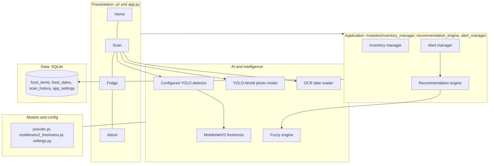

# System architecture

FreshTrack is a **utility-based agent with learning components**. It senses the world through photos, keeps a model of what is in the fridge, and chooses an action (what to eat first) by maximising a priority score.

## Agent description (for the paper)

| PEAS | Description |
|---|---|
| **Performance** | Food-ID accuracy, freshness classification accuracy, date-reading accuracy, expiring items flagged on time, fewer items wasted |
| **Environment** | A household fridge and pantry: food photos, package labels, the calendar |
| **Actuators** | Inventory updates, expiry alerts, a ranked "use first" list with reasons |
| **Sensors** | Uploaded or camera photos, OCR on packaging text, user confirmations, the system clock |

Environment properties: **partially observable** (only what is in frame; spoilage inside packaging is hidden), **stochastic** (spoilage depends on storage), **sequential and dynamic** (freshness changes over time), **mixed discrete and continuous** (categories and a 0-100 score), **single agent**.

## Layers

| Layer | Files | Responsibility |
|---|---|---|
| Presentation | `app.py`, `ui/*`, `assets/styles.css` | Pages, forms, cards; no business rules |
| Application | `inventory_manager.py`, `alert_manager.py`, `recommendation_engine.py` | Validation, alerts, ranking and explanations |
| AI | `food_detector.py`, `freshness_classifier.py`, `expiration_date_reader.py`, `fuzzy_engine.py` | Perception and decision-making |
| Data | `database_manager.py`, `database/schema.sql` | The only code that touches SQLite |
| Infrastructure | `config/settings.py`, `models/`, `training/` | Paths, thresholds, checkpoints, training |

## Data flow

1. **Food photo** -> configured YOLO detector identifies supported objects; photo scans also run local YOLO-World prompts -> supported produce is cropped -> MobileNetV2 returns Fresh / Aging / Visible spoilage with confidence when that food is in the loaded checkpoint -> the user confirms suggestions -> items land in SQLite. Live camera uses only the configured primary detector.
2. **Package photo** -> OpenCV cleans the image -> Tesseract reads lines with confidences -> the parser attaches each date to its printed label -> the user confirms (ambiguous dates are never guessed) -> a verified date row is stored.
3. **Ranking** -> for each item the alert manager finds the earliest *verified* expiry-type date; the fuzzy engine combines days remaining, visible decay and storage time into a 0-100 priority; the recommendation engine sorts items into *use first*, *check before eating*, *waiting on a date* and *no rush*, with reasons.

Photo scans also use a local YOLO-World open-vocabulary model with prompts for meat, seafood, dairy, bakery and packaged foods, including hot dogs. This is an additional photo-scan path; it is not custom-trained or evaluated on FreshTrack meat/dairy images. The live camera uses the configured primary detector and does not use this broader YOLO-World model. Detector recognition and freshness classification are separate: only foods supported by the loaded freshness checkpoint receive a freshness estimate.

## Evaluation evidence and limitations

- The 63-class produce detector's held-out LVIS test report covers 180 images and gives mAP50 **0.1815**, mAP50-95 **0.1088**, cucumber AP50 **0.267**, and banana AP50 **0.834**. These results do not establish reliable household-camera recognition.
- The separate `mobilenetv2_fresh_stale.pt` freshness checkpoint scored **98.27% accuracy** and **0.965 macro-F1** on 3,294 held-out dataset images. Spoiled recall was **0.927** on 245 examples. This is not the app's default freshness checkpoint, and no household-photo evaluation is available.
- The test split has no spoiled examples for bitter gourd, capsicum, or tomato; spoiled-condition performance for those foods cannot be inferred.
- Both freshness checkpoints have embedded November 2026 creation timestamps later than the stated November 6 project deadline. The expanded evaluation report is dated November 6, but checkpoint provenance must be resolved before claiming these results were available by the deadline.
- The open-vocabulary model's food prompts are not evidence of custom training or measured accuracy for those foods. User confirmation remains necessary.

## Fuzzy logic

Inputs: days until a verified date (passed / imminent / soon / later), visible decay from the freshness label (low / medium / high), days in storage (short / medium / long). Output: priority 0-100 (low / moderate / high / urgent), defuzzified by centroid. Rules are tables in `modules/fuzzy_engine.py` and read like sentences. Missing inputs use a reduced rule set; with no date and no trusted freshness reading the engine returns **no score** instead of inventing one.

## Safety rules enforced in code (and tested)

- Only verified dates make expiry claims; manufacturing and packing dates never do.
- Ambiguous dates are never guessed; no date is invented when OCR fails.
- Visibly spoiled food and food past an expiration or use-by date never appear on the "use first" list.
- A low-confidence freshness reading is shown as "not sure" and ignored by the fuzzy engine.
- Nothing presents a priority score or a "Fresh" label as proof of safety.
